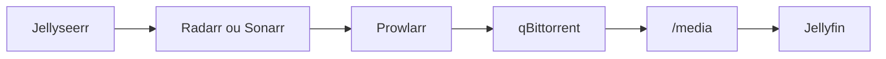

# Homelab

GitOps de um nó Talos (`talos-o0s-vw5`, ~12 GiB de RAM, LAN `192.168.0.42`). O que está em `main` neste repositório é o que o cluster roda: o Argo CD lê o GitHub e aplica os charts e os manifestos.

Três charts Helm cobrem o dia a dia — mídia, fotos e arquivos — e manifests crus cobrem o disco, o n8n, o Ingress do Argo CD e os operadores (Traefik, Tailscale, kube-prometheus-stack).

## O que sobe

| App Argo | Namespace | O que é |
|---|---|---|
| `media` | `media` | Jellyfin, Jellyseerr, Radarr, Sonarr, Prowlarr, qBittorrent |
| `photos` | `photos` | Immich (servidor, machine learning, Postgres, Valkey) |
| `drive` | `drive` | Seafile CE, MariaDB, Redis |
| `disk` | `kube-system` | Monta as partições de fotos e arquivos do Seagate e cria os PVs |
| `n8n` | `n8n`, `n8n-sandbox` | n8n, SearXNG e o sandbox de código da IA |
| `monitoring` | `monitoring` | kube-prometheus-stack (Prometheus, Grafana, Alertmanager) |
| `traefik` | `traefik` | Ingress da LAN, `hostPort` 80 |
| `tailscale` | `tailscale` | Tailscale Kubernetes Operator |
| `argocd-ingress` | `argocd` | Ingress do próprio Argo CD |
| `homelab` | `argocd` | App of apps: observa `argocd/apps` |

O pedido de um filme passa por esta cadeia:



1. O Jellyseerr recebe o pedido.
2. Radarr ou Sonarr cria o item.
3. O Prowlarr acha o release nos indexers.
4. O qBittorrent baixa em `/downloads`.
5. O arquivo importado vai para `/media/movies` ou `/media/tv` e aparece no Jellyfin.

A GeForce 520 fica de fora. Sem NVENC útil para o Jellyfin e sem CUDA útil para o Immich. Prefira direct play. O reconhecimento de fotos roda na CPU, com um worker e limite de 2 GiB, para não disputar RAM com o Jellyfin.

## Acesso

O Traefik escuta na porta 80 do nó. O sslip.io resolve `*.192.168.0.42.sslip.io` para `192.168.0.42`, então a LAN não precisa de DNS local.

| Serviço | LAN | Tailscale |
|---|---|---|
| Jellyfin | http://jellyfin.192.168.0.42.sslip.io | `jellyfin.<tailnet>.ts.net` |
| Jellyseerr | http://seerr.192.168.0.42.sslip.io | `seerr.<tailnet>.ts.net` |
| Radarr | http://radarr.192.168.0.42.sslip.io | — |
| Sonarr | http://sonarr.192.168.0.42.sslip.io | — |
| Prowlarr | http://prowlarr.192.168.0.42.sslip.io | — |
| qBittorrent | http://qbit.192.168.0.42.sslip.io | — |
| Immich | http://photos.192.168.0.42.sslip.io | `photos.<tailnet>.ts.net` |
| Seafile | http://drive.192.168.0.42.sslip.io | https://drive.taileba3bd.ts.net |
| n8n | http://n8n.192.168.0.42.sslip.io | https://n8n.taileba3bd.ts.net |
| Webhooks do n8n | caminhos `/webhook*` no Traefik | https://n8n-hooks.taileba3bd.ts.net (Funnel) |
| Grafana | http://grafana.192.168.0.42.sslip.io | — |
| Alertmanager | http://alertmanager.192.168.0.42.sslip.io | — |
| Argo CD | http://argocd.192.168.0.42.sslip.io | `argocd.<tailnet>.ts.net` |

O tailnet é `taileba3bd.ts.net`. O editor do n8n e os links gerados pelo Seafile usam esse nome (`N8N_EDITOR_BASE_URL` e `server.publicHost`). A porta BitTorrent do qBittorrent é um NodePort (`6881`), para peers de fora do cluster.

Sem Ingress, o port-forward usa o Service `{release}-{chart}-{app}`:

```bash
kubectl -n media port-forward svc/media-homelab-arr-jellyfin 8096:8096
kubectl -n media port-forward svc/media-homelab-arr-jellyseerr 5055:5055
kubectl -n photos port-forward svc/photos-homelab-immich-server 2283:2283
kubectl -n drive port-forward svc/drive-homelab-seafile-server 8080:80
kubectl -n n8n port-forward svc/n8n 5678:5678
```

## Disco

Seagate `ST1000LM048-2E71`, três partições XFS. O DaemonSet `photos-files-disk` em `homelab-disk/volumes.yaml` só monta fotos e arquivos, no nó `talos-o0s-vw5`. Ele confere o modelo do disco, o partlabel, o tipo XFS e o tamanho antes de montar.

| Partição | Tamanho | Onde | Quem usa |
|---|---|---|---|
| `movies` (`sdb1`) | 400 Gi | DaemonSet `movies-disk`, fora deste repo | a biblioteca de filmes no disco; o chart ARR hoje não aponta para ela |
| `photos` (`sdb2`) | 280 Gi | `/var/mnt/photos` → PV `photos-library` (`Retain`, StorageClass `movies-hdd`) | biblioteca do Immich (`existingClaim: photos-library`) |
| `files` (`sdb3`) | 220 Gi | `/var/mnt/files` → PV `files-data` (`Retain`, StorageClass `movies-hdd`) | dados do Seafile (`existingClaim: files-data`) |

O resto fica no SSD, via StorageClass `local-path` (o tamanho do PVC é teto prático, o provisioner não impõe cota):

| Dado | Tamanho |
|---|---|
| Mídia do ARR (`/media`) | 120 Gi |
| Downloads do ARR | 40 Gi |
| Postgres do Immich | 10 Gi |
| Cache de modelos do Immich | 8 Gi |
| MariaDB do Seafile | 8 Gi |
| Dados do n8n | 5 Gi |
| Prometheus (retenção 2 dias ou 6 GiB) | 8 Gi |
| Grafana e Alertmanager | 2 Gi cada |

Configs de cada app `*arr` e do Jellyfin também são PVCs `local-path` pequenos (1–5 Gi).

Apagar o chart não apaga o PV do Seagate: a reclaim policy é `Retain`. O PVC do n8n (`n8n-data`) e o dos certificados do sandbox (`sandbox-tls`) estão presos a um volume já provisionado (`volumeName`) e marcados com `Prune=false`.

## Mudar o cluster

O fluxo normal é editar o Git e deixar o Argo aplicar.

1. Altere o values ou o manifesto.
2. Faça push em `main`.
3. A Application `homelab` (`argocd/root.yaml`) sincroniza `argocd/apps`.
4. Cada Application filha sincroniza o chart ou o diretório dela, com `selfHeal: true`.

`homelab` não faz prune. Apagar um arquivo em `argocd/apps` não remove a Application sozinho. As filhas fazem prune: um recurso que saiu do chart é removido do cluster.

O Argo lê `https://github.com/fenol64/homelab-helm.git`, não o diretório local. Um `helm upgrade` feito na mão é revertido no próximo self-heal.

Bootstrap, com o Argo CD já instalado e o commit já em `main`:

```bash
kubectl apply -f argocd/apps
kubectl apply -f argocd/root.yaml
```

O Traefik deste nó não preenche `status.loadBalancer`. Sem a health check em `argocd/ingress-health.lua` (chave `resource.customizations.health.networking.k8s.io_Ingress` no `argocd-cm`), toda Application com Ingress fica `Progressing`. A função marca o Ingress `traefik` como Healthy e só espera load balancer no Ingress `tailscale`.

Para ver o que um chart renderiza antes do push:

```bash
helm template media ./homelab-arr -f ./homelab-arr/values-homelab.yaml
helm template photos ./homelab-immich -f ./homelab-immich/values-homelab.yaml
helm template drive ./homelab-seafile -f ./homelab-seafile/values-homelab.yaml
```

## Instalar sem o Argo

Útil no primeiro boot, ou para testar um values local. Helm 3 e `kubectl` no contexto do cluster.

```bash
kubectl apply -f homelab-disk/volumes.yaml

helm upgrade --install media ./homelab-arr \
  -n media --create-namespace \
  -f ./homelab-arr/values-homelab.yaml

helm upgrade --install photos ./homelab-immich \
  -n photos --create-namespace \
  -f ./homelab-immich/values-homelab.yaml

helm upgrade --install drive ./homelab-seafile \
  -n drive --create-namespace \
  -f ./homelab-seafile/values-homelab.yaml

kubectl label namespace monitoring pod-security.kubernetes.io/enforce=privileged --overwrite
helm repo add prometheus-community https://prometheus-community.github.io/helm-charts
helm repo update
helm upgrade --install kube-prometheus-stack prometheus-community/kube-prometheus-stack \
  -n monitoring --create-namespace \
  -f monitoring/values-homelab.yaml

kubectl apply -f n8n/
```

O chart `monitoring` que o Argo instala é o `kube-prometheus-stack` `93.6.0`. O namespace `monitoring` precisa de Pod Security `privileged`, senão o node-exporter não sobe. O Prometheus roda como root: o operator monta o TSDB em `subPath`, o kubelet cria essa pasta como root e o `fsGroup` não vale para `subPath`.

`values.yaml` de cada chart é o default genérico (Ingress desligado, StorageClass vazio). `values-homelab.yaml` é o que este nó usa e o que o Argo passa em `valueFiles`.

Conferir:

```bash
kubectl get applications -n argocd
kubectl -n media get pods,svc,pvc
kubectl -n photos get pods,pvc
kubectl -n drive get pods,pvc
```

## Primeiro acesso

Ordem da stack de mídia, uma vez:

1. **qBittorrent** — senha da WebUI e pasta `/downloads`.
2. **Prowlarr** — indexers, depois Apps sincronizando Radarr e Sonarr.
3. **Radarr** — root folder `/media/movies` e download client no Service do qBittorrent.
4. **Sonarr** — root folder `/media/tv` e o mesmo download client.
5. **Jellyfin** — bibliotecas em `/media/movies` e `/media/tv`.
6. **Jellyseerr** — conectar Jellyfin, Radarr e Sonarr.

Hosts internos, com a release `media`:

| App | DNS |
|---|---|
| qBittorrent | `media-homelab-arr-qbittorrent.media.svc.cluster.local:8080` |
| Radarr | `media-homelab-arr-radarr.media.svc.cluster.local:7878` |
| Sonarr | `media-homelab-arr-sonarr.media.svc.cluster.local:8989` |
| Prowlarr | `media-homelab-arr-prowlarr.media.svc.cluster.local:9696` |
| Jellyfin | `media-homelab-arr-jellyfin.media.svc.cluster.local:8096` |

**Immich.** No primeiro acesso a interface pede a conta de administrador. A senha do Postgres não é essa senha. `database.password` só entra quando o PVC do banco é criado; mudar o values depois não rotaciona o Postgres.

**Seafile.** Login `admin@home.arpa`. A senha é `server.admin.password` em `homelab-seafile/values-homelab.yaml` e só é aplicada na primeira subida. Troque depois pela interface. SeaDoc, WebDAV, notificações, metadata e IA ficam desligados: o chart sobe o drive.

**n8n.** Os Secrets não estão no Git e precisam existir antes do sync: `n8n-secrets` (`N8N_ENCRYPTION_KEY`, `N8N_SANDBOX_SERVICE_API_KEY`), `searxng-secrets` (`SEARXNG_SECRET`) e `n8n-sandbox-secrets` (`API_KEY`, `REGISTRATION_TOKEN`, `RUNNER_KEY`). O SearXNG serve a busca do assistente (JSON ligado no ConfigMap). O sandbox roda no namespace `n8n-sandbox`, com Pod Security `privileged`, porque o runner é Docker-in-Docker. NetworkPolicy deixa o n8n falar só com a API do sandbox, e o SearXNG só aceita tráfego do n8n.

O client OAuth do Tailscale Operator não está no Git: em `argocd/apps/tailscale.yaml` os campos ficam vazios. A senha de admin do Grafana também fica de fora do diff do Argo (`ignoreDifferences` no Secret `kube-prometheus-stack-grafana`), para o render do Helm não rotacionar a senha a cada sync.

## Memória

Requests cabem no nó. A soma dos limits passa de 12 GiB: um pico junto de Jellyfin, machine learning e sandbox aperta o nó.

| Workload | Request | Limit |
|---|---|---|
| Jellyfin | 512 Mi | 1.5 Gi |
| Jellyseerr | 128 Mi | 384 Mi |
| Radarr / Sonarr | 256 Mi cada | 512 Mi cada |
| Prowlarr | 128 Mi | 384 Mi |
| qBittorrent | 256 Mi | 768 Mi |
| Immich server | 384 Mi | 1.5 Gi |
| Immich ML | 512 Mi | 2 Gi |
| Postgres do Immich | 256 Mi | 1 Gi |
| Seafile | 256 Mi | 768 Mi |
| MariaDB | 256 Mi | 768 Mi |
| n8n | 256 Mi | 1 Gi |
| SearXNG | 256 Mi | 512 Mi |
| Sandbox runner | 512 Mi | 2 Gi |
| Prometheus | 256 Mi | 1 Gi |
| Grafana | 128 Mi | 384 Mi |

Idle da stack de mídia fica em torno de 2–3 GiB.

## Layout

```
argocd/
  root.yaml              app of apps
  apps/                  uma Application por componente
  ingress.yaml           LAN e Tailscale do Argo CD
  ingress-health.lua     health check de Ingress para o argocd-cm
homelab-arr/             chart da stack de mídia
homelab-immich/          chart do Immich
homelab-seafile/         chart do Seafile
homelab-disk/volumes.yaml
monitoring/values-homelab.yaml
n8n/                     n8n, SearXNG, sandbox e Funnel dos webhooks
```

Cada chart tem `values.yaml` (default) e `values-homelab.yaml` (este nó). Fuso de tudo que o chart controla: `America/Sao_Paulo`. UID/GID dos containers linuxserver: `1000`.

## Fora deste corte

- Sem sidecar de VPN no qBittorrent.
- Sem Bazarr nem Lidarr. Cada app do chart ARR tem `enabled` e dá para acrescentar outro no mesmo molde.
- Sem aceleração de hardware na GeForce 520.
- A partição `movies` de 400 Gi é montada por um DaemonSet que não está neste repositório. O PVC de mídia do chart usa `local-path` no SSD (120 Gi).
- Senhas de primeiro boot do Immich e do Seafile estão nos `values-homelab.yaml` commitados. Elas não rotacionam o que já subiu.
